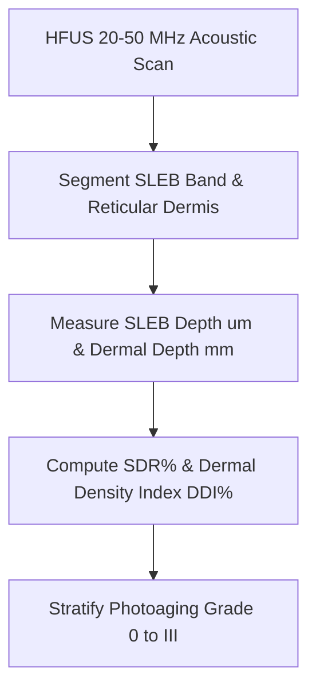

# Cutaneous High-Frequency Ultrasound SLEB Personal Agent Skill

[](LICENSE)
[](https://www.python.org/)
[]()
[]()
[]()

Deterministic, zero-mock personal agent micro-skill for calculating 20-50 MHz High-Frequency Ultrasound (HFUS) Subepidermal Low-Echogenic Band (SLEB) thickness, Dermal Thickness, SLEB-to-Dermis ratio (SDR%), and Dermal Density Index (DDI%).

## Architecture



## Quickstart

```python
from client import HighFrequencyUltrasoundSLEBClient

client = HighFrequencyUltrasoundSLEBClient()
result = client.evaluate_sleb_metrics(
    sleb_thickness_um=25.0,
    total_dermal_thickness_mm=1.35,
    mean_dermal_echogenicity_greyscale=175.0,
    patient_age_years=26
)
print(result)
```

## License

Apache-2.0
